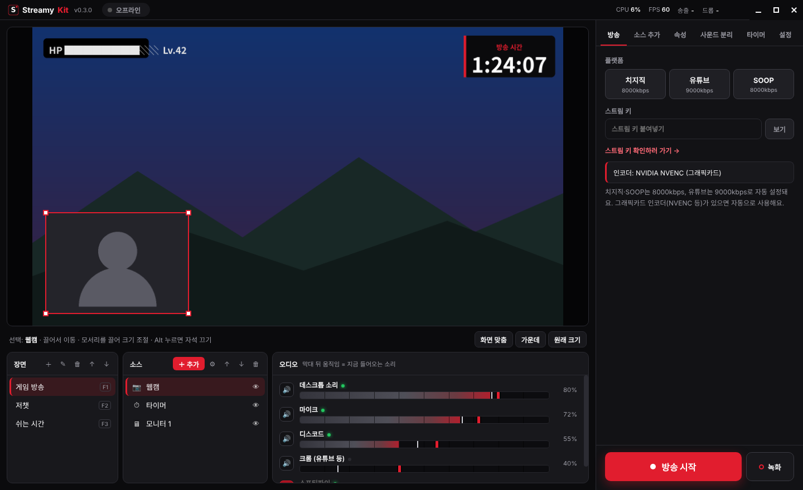

<div align="center">


# Streamy Kit

**치지직 · 유튜브 · SOOP 스트리머를 위한 방송 프로그램**

OBS의 검증된 방송 엔진 위에, 한국 스트리머에게 맞춘 화면과 기능을 새로 얹었습니다.


-2A2A31)


</div>

<p align="center"></p>

---

## 목차
1. [Streamy 서비스 전체 구조](#1-streamy-서비스-전체-구조)
2. [Streamy Kit 주요 기능](#2-streamy-kit-주요-기능)
3. [기술 구조](#3-기술-구조)
4. [폴더 구조](#4-폴더-구조)
5. [개발 / 빌드 방법](#5-개발--빌드-방법)
6. [수익 모델 방안](#6-수익-모델-방안)
7. [로드맵](#7-로드맵)
8. [라이선스 (GPL) 정책](#8-라이선스-gpl-정책)

---

## 1. Streamy 서비스 전체 구조

Streamy는 **방송 도구 + 커뮤니티 + 홍보 플랫폼**을 하나로 묶은 스트리머 생태계입니다.

```
                         ┌──────────────────────────────┐
                         │            Streamy           │  전체 브랜드 / 계정 / 토큰
                         └──────────────┬───────────────┘
              ┌─────────────────────────┼─────────────────────────┐
              ▼                         ▼                         ▼
   ┌────────────────────┐   ┌────────────────────┐   ┌────────────────────┐
   │    Streamy Kit     │   │       Clubby       │   │   Streamy 메인     │
   │   (방송 프로그램)   │   │ (스트리머 커뮤니티) │   │  (스포트라이트/홍보) │
   │  ← 이 저장소        │   │  트게더 역할        │   │                    │
   └─────────┬──────────┘   └─────────┬──────────┘   └─────────┬──────────┘
             │  방송 켜짐/꺼짐 자동 공지 │  인기글·클립·대회 홍보    │
             └────────────── 연동 ──────┴──────────────────────────┘
                                  │
                                  ▼
                     최종 목표: 상원 MCN 설립
```

| 서비스 | 역할 | 상태 |
|---|---|---|
| **Streamy Kit** | OBS 엔진 기반 방송 프로그램. 화면 구성 · 사운드 분리 · 동시 송출 · 통합 채팅 · 방송 정보 · 버추얼 | **v0.26 (이 저장소, 자동 업데이트로 배포 중)** |
| **Clubby** | 스트리머별 커뮤니티 (게시판, 태그, 유저 갤러리, 팬아트, 영구제 꾸미기). 스트리머마다 이름 앞글자를 바꿔 쓰는 구조 | 기획 |
| **Streamy 메인** | 출석(토큰), 지금 방송 중인 스트리머 스포트라이트(대 3칸 + 소 5칸), 핫클립, 방송 홍보, 게임대회 홍보, 공지·건의 | 기획 |

> 지원 플랫폼: **치지직 · 유튜브 · SOOP** 3곳 전용

---

## 2. Streamy Kit 주요 기능

> 기준 버전: **v0.26** (최신은 [릴리스](https://github.com/Streamys/Streamy_kit/releases) 참고 · 앱은 자동으로 최신 빠른 업데이트를 받습니다)

### 화면
| 영역 | 내용 |
|---|---|
| 왼쪽 | **장면** (F1~F9 전환, ＋추가 · 삭제, 끌어서 순서 · [삭제]로 끌어 빼기) · **소스** (＋추가 오버레이, 끌어서 순서, 눈 버튼) |
| 가운데 | **미리보기** (끌어서 이동 · 모서리로 크기 · 자석 맞춤) · 정렬 버튼 줄 · **사운드** 믹서 |
| 오른쪽 탭 | **방송 · 채팅 · 소스 · 버추얼 · 사운드 · 설정** |
| 세팅 / ON AIR | 준비용 화면과 방송 중 화면 두 가지 |
| 화면 꾸미기 | 제목줄 [레이아웃] → 글자 크기(80~130%) · 글꼴(설치된 것 / 파일 가져오기) · 칸을 끌어서 배치 · 기둥 너비 / 칸 높이 조절 |
| 테마 | 밝게 · 어둡게 · 자동, **포인트 색** 선택 (버튼 · 아이콘 · 체크 상자 · 앱 아이콘까지 따라감), 순흰색/순검정 대신 눈 편한 톤 |
| 디자인 요소 | 직접 그린 단색 플랫 아이콘, 앱 디자인 확인 · 안내 창, 둥근 체크 상자, 엔진 준비 화면(막대) |

### 송출 · 방송 정보
- **동시 송출**: 치지직 · 유튜브 · SOOP 스트림 키를 저장해 두면 한 번에 송출 (키를 붙이면 어느 플랫폼인지 알아봄)
- **방송 정보 탭**: [통합] [치지직] [유튜브] [SOOP]
  - 통합: 공통 제목 · 태그 · 설명, 플랫폼별 카테고리, 적용할 곳 고르기, [모두 적용], 방송 시작 시 자동 적용
  - 플랫폼 탭: [통합 내용 사용] / [따로 설정] + 그 플랫폼에만 적용
  - 로그인: Streamy 앱 + 릴레이(Cloudflare Worker)로 버튼만 누르면 됨 (SOOP은 개발자 앱 심사 중)
- 화질(1080p60 등)은 방송 탭 맨 아래

### 채팅 · 시청자
- 치지직 · 유튜브 · SOOP 채팅을 한 곳에 (등급 배지, 후원 강조, 한 줄 보기)
- 채널은 **로그인한 계정에서 자동** (치지직 · 유튜브), 통합 시청자 수
- **최소화 오버레이**: 방송 상태 + 최근 채팅, 앱 테마 · 포인트 색 · 글꼴을 그대로 따라감

### 사운드
- 데스크톱 소리 · 마이크 · **프로그램별 소리 분리** (디스코드 · 크롬 · 게임 …)
- 사운드 탭에서 기본 장치 선택 (마이크 '사용 안 함' 가능)
- **블루투스 이어폰 마이크 감지**: 버즈 · 에어팟 마이크를 쓰면 윈도우가 통화 모드로 바꿔 음질이 떨어지는 걸 알려 주고 다른 마이크 / 끄기 선택

### 버추얼
- **원클릭 연결**: 켜져 있는 버추얼 프로그램(VTube Studio, VSeeFace, Warudo, VNyan …)을 찾아 화면에 띄움
- **VTube Studio 조종**: 공개 API(포트 8001)로 모델 · 표정 · 단축키 · 위치, Spout2로 깨끗한 화면
- VTube Studio는 [켜기] · [연결]을 눌렀을 때만 실행 · 연결 (몰래 켜지 않음)

### 소스
모니터 · 프로그램 창 · 게임 · 웹캠 · 이미지 · 텍스트 · 웹페이지(알림창) · 타이머 · 버추얼 · 단색
- 사진 파일 · 알림창 주소를 창에 **끌어다 놓으면** 바로 추가
- 모니터 · 창 · 웹캠 목록은 **엔진에 묻지 않고** 윈도우에서 직접 읽음 (일부 PC에서 엔진 조회 시 꺼지는 문제 회피)

### 업데이트
- `package.json` 버전을 올려 main에 푸시 → GitHub Actions가 **빠른 업데이트 ZIP**을 릴리스에 게시 → 앱이 받아서 다시 켜짐 (방송 · 녹화 중이면 끝난 뒤)
- 새 패치가 켜지다 실패하면 이전 버전으로 자동으로 되돌아감
- 바탕화면 `Streamy Kit 업데이트` 폴더에 패치 ZIP을 넣어도 적용됨 (개발용 · 서명 검증 붙일 때 개발자 모드로 제한 예정)

### 보안 · 개인정보
- 플랫폼 로그인 토큰과 **스트림 키는 윈도우 보안 저장(safeStorage)으로 암호화**해서 이 PC · 이 계정에만 저장
- 앱에는 플랫폼 Client ID만 들어 있고 Client Secret은 릴레이(Cloudflare Worker) 환경 변수에만 있음
- 예정: 업데이트 전자서명 검증, 화면 쪽 권한 줄이기(contextIsolation + preload), 버추얼 지킴이(실제 웹캠 · 민감한 창 노출 방지), Streamy Kit 창 캡처 제외

## 3. 기술 구조

OBS Studio를 **고쳐 쓰지 않고**, OBS의 방송 엔진(libobs)만 부품으로 가져와 화면은 처음부터 새로 만들었습니다.
(Streamlabs Desktop과 같은 방식)

```
┌─────────────────────────── Streamy Kit (Electron 43) ───────────────────────────┐
│                                                                                 │
│  메인 프로세스 (src/main.js)            렌더러 = 화면 (src/renderer)               │
│  ├ 창 · 트레이 · 종료 처리              ├ index.html / style.css  블랙·레드 UI     │
│  ├ 파일 선택 · 외부 링크                ├ app.js     장면/소스 목록, 끌기·크기 조절, │
│  └ 로컬 서버 127.0.0.1:17890            │            믹서, 송출 버튼, 설정 저장     │
│     (src/server.js → 타이머 오버레이)    └ engine.js  OBS 엔진 래퍼 ─────────┐       │
│                                                                         │       │
└─────────────────────────────────────────────────────────────────────────┼───────┘
                                                                          │ N-API
                                         ┌────────────────────────────────▼───────┐
                                         │ obs-studio-node (Streamlabs, GPL-2.0)  │
                                         │ obs_studio_client.node                 │
                                         └────────────────┬───────────────────────┘
                                                          │ IPC (named pipe)
                                         ┌────────────────▼───────────────────────┐
                                         │ obs64.exe  =  libobs + 플러그인          │
                                         │ 게임/화면/창 캡처 · WASAPI 앱별 오디오     │
                                         │ NVENC/AMF/QSV/x264 · RTMP(S) · Spout2   │
                                         │ 브라우저 소스(CEF)                        │
                                         └──────────────┬──────────────────────────┘
                                                        │ 미리보기 = 자식 창(HWND)
                                                        ▼ 마우스는 통과 → 화면이 받아 편집 처리
```

### 핵심 설계
| 항목 | 방식 |
|---|---|
| 미리보기 | 엔진이 Electron 창 위에 자식 창으로 직접 그림. 마우스 입력은 투명하게 통과시켜, 화면(JS)이 받아서 클릭 위치 → 캔버스 좌표로 변환 후 선택 · 이동 · 크기 조절 |
| 장면 전환 | 출력 채널 0 = 페이드 전환 → 현재 장면 |
| 오디오 | 출력 채널 9 = **오디오 버스**(영상 없는 숨은 장면). 데스크톱 · 마이크 · 앱별 소리를 여기 두어 **어떤 장면에서도 항상 들림** |
| 레벨 막대 | 볼륨미터(IEC) 콜백 → dB를 0~1로 변환 (−60dB~0dB) → 올라갈 땐 즉시, 내려갈 땐 천천히 |
| 앱별 소리 | `wasapi_process_output_capture`, 실행 파일 이름으로 매칭 (`priority: 2`) → 앱이 꺼져 있다 켜져도 자동으로 잡힘 |
| 지금 나오는 소리 | `src/audio-sessions.ps1` — 윈도우 Core Audio 세션(IAudioSessionManager2 · IAudioMeterInformation)을 0.15초마다 읽는 별도 프로세스. 엔진과 분리돼 있어 문제가 생겨도 방송에 영향 없음 |
| 장치·창 목록 | 조회용 소스를 한 번만 만들어 재사용 (매번 만들고 지우면 엔진이 불안정해짐) |
| 동시 송출 | 플랫폼마다 출력 + 인코더를 따로 만들어 동시에 RTMP 송출 |
| 통합 시청자 | 메인 프로세스가 1분마다 치지직 공개 라이브 정보에서 동시 시청자 수를 가져와 합산 (유튜브 · SOOP는 연결 예정) |
| 안정성 | 화면을 먼저 그리고 엔진은 그다음 시작(엔진 준비 막대 · 켜는 동안엔 '응답 없음' 창을 띄우지 않음), 지난번에 남은 엔진 프로세스 자동 정리(이 설치본 것만), 화면 충돌 시 자동 복구, 20초 응답 없음 시 재시작 안내, 종료 시 창 먼저 숨기고 8초 안에 강제 정리, GPU 오류 반복 시 그래픽 가속 자동 끄기 |
| 로그 | `%APPDATA%\Streamy Kit\logs\streamy-kit.log` — 설정 → 문제 해결 또는 트레이 메뉴에서 열기 |
| 저장 | `%APPDATA%\Streamy Kit\settings.json` (설정 · **스트림 키는 암호화**) / `scenes.json` (장면 · 소스 · 배치) / `broadcast-info.json` (로그인 토큰, 암호화) |

---

## 4. 폴더 구조

```
Streamy_kit/
├─ src/
│  ├─ boot.js               시작 파일 — 빠른 업데이트가 있으면 그 코드로 켬 (안전장치 포함)
│  ├─ unzip.js              업데이트 ZIP 풀기 (PowerShell 없이, 빠름)
│  ├─ main.js               Electron 메인 프로세스 (창, 트레이, IPC, 종료)
│  ├─ server.js             로컬 HTTP 서버 — 타이머 상태 + 오버레이 페이지 (SSE)
│  ├─ log.js                파일 로그 (%APPDATA%\Streamy Kit\logs)
│  ├─ chat.js               통합 채팅 수집기 (치지직 웹소켓 · 유튜브 InnerTube · SOOP 웹소켓 → 같은 모양으로)
│  ├─ updater.js            업데이트 확인 · 준비 · 조용한 설치 (바탕화면 폴더 → GitHub Releases)
│  ├─ audio-sessions.ps1    지금 소리 나는 프로그램 + 레벨 (윈도우 오디오 세션)
│  ├─ windows.ps1           켜져 있는 프로그램 창 목록 (사운드 분리 · 버추얼 감지 · 창 캡처 목록, 엔진과 따로)
│  ├─ monitors.ps1          모니터 목록 (OBS 모니터 캡처 장치 ID 형식, 엔진과 따로)
│  ├─ broadcast.js          플랫폼 로그인(OAuth) · 방송 정보 적용 (치지직 · 유튜브)
│  ├─ vts.js                VTube Studio 공개 API 클라이언트
│  ├─ tray.png
│  ├─ overlays/
│  │  └─ timer.html         방송 화면용 타이머 (브라우저 소스로 들어감)
│  └─ renderer/
│     ├─ index.html         화면 구조
│     ├─ style.css          디자인 (밝게 · 어둡게 · 포인트 색)
│     ├─ icons.js           단색 플랫 아이콘 (직접 그린 SVG)
│     ├─ app.js             화면 로직 (장면·소스·믹서·송출·끌기 편집·채팅·버추얼·저장)
│     ├─ mini.html / mini.js 최소화 오버레이 (방송 상태 + 최근 채팅)
│     ├─ guide.html / guide.js 미리보기 편집 가이드 (투명 창에 테두리 · 손잡이 · 크기)
│     ├─ engine.js          OBS 엔진 래퍼 (장면/소스/오디오/송출/녹화)
│     └─ demo-preview.png   개발용 미리보기 이미지 (STREAMY_DEMO=1)
├─ .github/workflows/
│  ├─ quick-release.yml     main에 새 버전 푸시 → 빠른 업데이트 ZIP 만들어 릴리즈 자동 게시
│  └─ release.yml           (수동) 설치 파일 빌드 → 같은 릴리즈에 첨부
├─ build/
│  ├─ build-win.sh          윈도우 설치 파일 원클릭 빌드
│  ├─ make-patch.sh         빠른 업데이트 ZIP 만들기 (src만)
│  ├─ patch-min-base        빠른 업데이트를 받을 수 있는 최소 설치 버전
│  ├─ installer.nsi         NSIS 설치 스크립트 (한국어/영어, VC++ 런타임, GPL 페이지, /S /relaunch 업데이트 모드)
│  ├─ LICENSE.txt           GPL-2.0 전문 (설치 화면에 표시)
│  ├─ NOTICE.txt            오픈소스 고지
│  └─ icon.ico / icon.png
├─ relay/                  Cloudflare Worker (OAuth 릴레이 · 개인정보처리방침 · 약관 페이지)
├─ docs/
│  ├─ PLAN.md               서비스 기획 (브랜드, 수익 모델, Clubby, 로드맵)
│  └─ images/
├─ package.json
└─ LICENSE
```

---

## 5. 개발 / 빌드 방법

### 새 버전 배포 (자동)
1. `package.json`의 `version`을 올리고 커밋 · main에 푸시
2. `quick-release.yml`이 그 버전 릴리즈가 없으면 빠른 업데이트 ZIP을 만들어 릴리즈 `v<버전>` 게시 (1분 안팎, 태그도 자동)
3. 켜져 있는 앱이 5분 안에 받아서 알아서 적용 (방송·녹화 중이면 끝난 뒤)

엔진 · Electron · `node_modules`가 바뀐 버전은 빠른 업데이트로 안 돼요 → `build/patch-min-base`를 그 버전으로 올려서 푸시하고, Actions에서 **릴리스 설치 파일 만들기 (수동)** 을 그 태그로 실행 (15분 안팎).

> 저장소가 **공개**라서 앱이 로그인 없이 릴리즈를 확인할 수 있어요.

### 화면만 띄워 보기 (어느 OS든)
방송 엔진은 윈도우 전용이라, 다른 OS에서는 예시 화면으로 UI만 확인할 수 있습니다.
```bash
npm install
STREAMY_DEMO=1 npm start
```

### 윈도우 설치 파일 만들기 (리눅스 / 맥 / WSL)
```bash
sudo apt install nsis        # macOS: brew install makensis
npm run build:win            # → dist/StreamyKit-Setup-<버전>-x64.exe
```
`build/build-win.sh`가 하는 일:
1. `npm install`
2. Streamlabs가 공개한 **obs-studio-node 0.27.40 윈도우 빌드**를 내려받음 (약 300MB, `.cache/`에 보관)
3. Electron **43.7.6** 윈도우용 패키징 (asar 미사용)
4. 엔진을 `resources/app/node_modules/obs-studio-node`에 넣고 `.pdb` 디버그 파일 삭제
5. NSIS로 설치 파일 생성 (VC++ 런타임 자동 설치 포함)

> ⚠️ **Electron 버전과 obs-studio-node 버전은 짝이 맞아야 합니다.** 엔진을 올리면 Streamlabs Desktop의 `scripts/repositories.json`과 obs-studio-node CI의 `ElectronVersion`을 확인해 Electron도 같이 맞추세요.

### 윈도우에서 바로 실행 (개발용)
```powershell
npm install
# obs-studio-node 압축을 풀어 node_modules\obs-studio-node 에 넣은 뒤
npm start
```

---

## 6. 수익 모델 방안

> 원칙: **프로그램은 무료로 뿌리고**, 계정 · 서버 기능 · 디자인 콘텐츠로 번다.
> (GPL 특성상 프로그램 자체 판매는 의미가 약함 — 아래 8번 참고)

| 구분 | 내용 | 예시 |
|---|---|---|
| **무료** | 기본 방송 기능 전부 + 광고 | 장면/소스 편집, 사운드 분리, 송출, 녹화 |
| **광고 토큰** | 광고 시청 · 출석으로 토큰 → 기능 잠깐 해금 / 홍보에 사용 | 스포트라이트 노출, 프리미엄 테마 하루 사용 |
| **월 구독** | 서버 비용이 계속 드는 기능 | AI 자동 배치(카메라 제외), 클라우드 설정 백업, 고급 매니저 봇, 멀티 송출 |
| **영구제** | 한 번 만들면 끝나는 콘텐츠 | 오버레이·타이머 스킨, 장면 테마 팩, Clubby 꾸미기(스킨/배너/이름) |

### 토큰 경제 체크포인트
- 부계정 출석 농사 방지 → 본인인증 또는 방송 채널 인증
- 스포트라이트 8칸 배분 → 토큰 경매 / 시간제 / 랜덤 순환 중 결정
- 유료 토큰 구매 허용 여부 → 허용 시 직접 매출원

---

## 7. 로드맵

| 단계 | 내용 | 상태 |
|---|---|---|
| v0.1 | OBS 도우미(외부에서 OBS 조작) 프로토타입 | ✅ 완료 → 방향 전환 |
| v0.2 | OBS 엔진 + 자체 UI 첫 버전, 설치 파일 | ✅ 완료 |
| v0.3 | 사용자 장면/소스, 미리보기 끌기·크기 조절, 실시간 레벨 믹서 | ✅ 완료 |
| v0.4 | 화면 재배치(정사각형 장면 버튼, 사운드 바 + ⚙ 분리 설정), 통합 시청자(👁), 상단 상태 표시 | ✅ 완료 |
| v0.4.1 | 안정성: 시작 지연·검은 화면 수정, 로그, 충돌/응답 없음 복구, 종료 정리, 불필요 플러그인 제거 | ✅ 완료 |
| v0.5 | 사운드 ⚙ 강제 종료 수정, 블랙바 제거, 창 버튼, 방송 탭(플랫폼별 키·상태, 동시 송출, 인코더 선택), 소스 탭(이름·이모지, 다중 선택), 사운드 탭(끌어다 분리) | ✅ 완료 |
| v0.5.1 | 스트림 키 입력 칸 하나 + 플랫폼 자동 추측, 인코더 콤보박스 + 자동 버튼 | ✅ 완료 |
| v0.6 | 앱 안 업데이트 버튼(받기 → 조용히 설치 → 자동 재시작), 바탕화면 폴더에 넣으면 자동 감지(v0.6.1), 릴리스 게시 시 설치 파일 자동 빌드 | ✅ 완료 |
| v0.7 | 채팅 탭: 통합 채팅(치지직·유튜브·SOOP, 후원 강조) + 플랫폼별 공식 채팅창, 채널 연결 3개, SOOP 송출 서버 주소 변경 반영 | ✅ 완료 |
| v0.8 | 세팅 / ON AIR 화면 분리, 최소화 오버레이(상태 + 최근 채팅, 플랫폼 선택), 부드러운 사운드 막대, 채팅 기록 on/off, 버추얼 원클릭 연결 · 자동 감지 · 세부 설정 | ✅ 완료 |
| v0.8.2 | 업데이트 바로 적용: 빠른 업데이트(src만, 몇 초, 허용 창 없음) + 자동 적용 + 실패 시 기본 버전으로 복구, 설치 파일 UAC 실행 수정 | ✅ 완료 |
| v0.8.3 (빠른 업데이트) | 사운드 분리: 켜진 프로그램 전부 → 사운드 칸에 끌어 넣기 / 끌어서 아무 데나 놓으면 빼기, 시작 직후 화면이 죽던 문제(엔진 창 조회) 수정, 마이크 목록 빈칸 수정 | ✅ 완료 |
| v0.8.4 (빠른 업데이트) | 미리보기 편집 가이드: 소스 테두리 · 모서리 손잡이 · 크기 표시 · 사용법 · 자석 안내선 · 커서 | ✅ 완료 |
| v0.8.5 (빠른 업데이트) | 바깥 아무 데나 누르면 소스 선택 해제 | ✅ 완료 |
| v0.8.6 (빠른 업데이트) | 편집 가이드 엔진 호출 대폭 줄임(위치 캐시), 화면이 죽으면 덤프(`Crashpad`) + 직전 동작 30개를 로그에 남김 | ✅ 완료 |
| v0.8.7 (빠른 업데이트) | 화면 맞춤 · 가운데 · 원래 크기 · 방향키 · 버추얼 설정 뒤 편집 가이드가 바로 따라옴 | ✅ 완료 |
| v0.8.8 (빠른 업데이트) | ON AIR에 스마트폰으로 볼 때 화면 (세로/가로) | ✅ 완료 |
| v0.8.9 (빠른 업데이트) | 방송 화면 ↔ 폰 화면 비율 조절 막대 | ✅ 완료 |
| v0.9.0 (빠른 업데이트) | GitHub 릴리즈 자동 업데이트: 버전 올려 푸시하면 Actions가 빠른 업데이트 게시 → 앱이 5분 안에 알아서 적용 | ✅ 완료 |
| **v0.9.1** (GitHub 릴리즈로만 배포) | 설정 → 업데이트에 GitHub 마지막 확인 시간 · 최신 버전 표시 (릴리즈 자동 업데이트 첫 실전 테스트) | ✅ 완료 |
| v0.10 ~ v0.14 | VTube Studio 조종 · 방송 정보(로그인 → 제목·태그·카테고리 적용) · 카드 디자인 · 다크 모드 · 포인트 색 · 탭 정리 · 채팅 새 디자인 | ✅ 완료 |
| v0.15 ~ v0.20 | 소스 추가 오버레이 · 끌어다 놓기 · 단색 플랫 아이콘 · 앱 아이콘 색 · 눈 편한 톤 · 화면 꾸미기(글자 크기 · 글꼴 가져오기 · 끌어서 배치 · 너비/높이) · 장면 추가/삭제 · 앱 디자인 확인 창 | ✅ 완료 |
| v0.21 ~ v0.26 | 엔진 조회로 꺼지던 문제 해결(모니터 · 창 · 웹캠 목록을 윈도우에서 직접) · 버추얼 탭 · 사운드 탭 · 글 줄이기 · 줄 맞춤 · 방송 정보 통합/플랫폼별 탭 · 최소화 오버레이 새 디자인 · 안내 창 · 체크 상자 · 엔진 준비 화면 · 블루투스 마이크 감지 · 스트림 키 암호화 | ✅ 완료 |
| 다음 | 업데이트 전자서명 검증 · 버추얼 지킴이(실제 웹캠 · 민감한 창 노출 방지, Streamy Kit 창 캡처 제외) · SOOP 로그인 연동 · 자동 테스트 · 화면 권한 줄이기 · 트래킹 모드(마우스 따라 확대) | 예정 |
| v0.8.x | 채팅 오버레이(방송 화면에 띄우기), 통합 채팅에서 바로 입력, 통합 시청자 유튜브·SOOP | 예정 |
| v0.9 | 실기 테스트 버그 수정, 소스 자르기(크롭)·회전, 필터(크로마키·노이즈 제거), 단축키 설정, 송출 설정 화면, 리플레이 버퍼 | 예정 |
| v1.0 | Streamy 계정 로그인, 플랫폼 로그인으로 스트림 키 자동 가져오기, 무료/유료 구분, 코드 서명, 전용 매니저 봇(모찌), AI 자동 배치 | 예정 |
| — | **Streamy 메인 / Clubby** 웹 서비스 오픈, Kit 연동 (방송 켜짐 자동 공지) | 예정 |
| — | 상원 MCN 설립 | 최종 목표 |

### 출시 전 체크리스트
- [ ] 윈도우 10 / 11, NVIDIA · AMD · 인텔 그래픽 실기 테스트
- [ ] 코드 서명 인증서 (SmartScreen 경고 제거)
- [ ] 상표 확인 — KIPRIS에서 "스트리미 / Streamy" (미국 *Streamy Awards* 존재)
- [ ] 도메인 확보 (`streamy.kr`, `streamy.gg` 등)
- [ ] 치지직 · SOOP · 유튜브 API 이용 약관 확인 (채팅·방송 상태 연동)
- [ ] 오픈소스 라이선스 검토 (변호사)

---

## 8. 라이선스 (GPL) 정책

Streamy Kit은 다음을 사용하므로 **GPL-2.0-or-later**로 배포됩니다.

| 구성 요소 | 라이선스 |
|---|---|
| [OBS Studio](https://github.com/obsproject/obs-studio) (libobs, 플러그인) | GPL-2.0-or-later |
| [obs-studio-node](https://github.com/stream-labs/obs-studio-node) (Streamlabs) | GPL-2.0 |
| [Electron](https://github.com/electron/electron) | MIT |

**지키는 것**
- ✅ 이 저장소에 소스 코드 공개
- ✅ 설치 화면에 GPL 전문, 시작 메뉴에 "오픈소스 고지"
- ✅ 제품명 · 로고에 "OBS"를 쓰지 않음 (OBS는 엔진으로만 사용)

**수익과의 관계**
- 프로그램은 누구나 재배포할 수 있으므로 **프로그램 자체 판매는 비추천**
- **서버에서 돌아가는 기능**(계정, AI 배치, 클라우드, 커뮤니티)과 **디자인 콘텐츠**(테마, 스킨)는 공개 의무 대상이 아님 → 여기서 수익화

> 이 문서는 법률 자문이 아닙니다. 정식 출시 전 오픈소스 라이선스에 밝은 변호사 검토를 권장합니다.

---

<div align="center">
<sub>Streamy · 치지직 · 유튜브 · SOOP 스트리머를 위해</sub>
</div>
