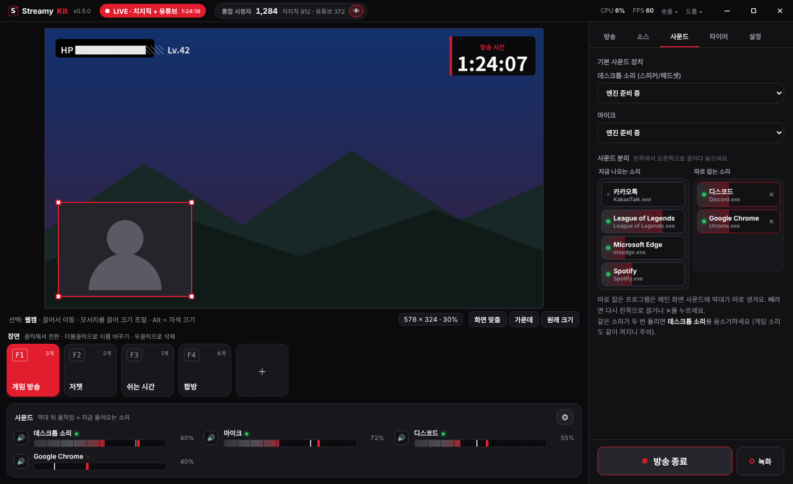

<div align="center">


# Streamy Kit

**치지직 · 유튜브 · SOOP 스트리머를 위한 방송 프로그램**

OBS의 검증된 방송 엔진 위에, 한국 스트리머에게 맞춘 화면과 기능을 새로 얹었습니다.


-2A2A31)


</div>

<p align="center"></p>

---

## 목차
1. [Streamy 서비스 전체 구조](#1-streamy-서비스-전체-구조)
2. [Streamy Kit 주요 기능](#2-streamy-kit-주요-기능)
3. [기술 구조](#3-기술-구조)
4. [폴더 구조](#4-폴더-구조)
5. [개발 / 빌드 방법](#5-개발--빌드-방법)
6. [수익 모델 방안](#6-수익-모델-방안)
7. [로드맵](#7-로드맵)
8. [라이선스 (GPL) 정책](#8-라이선스-gpl-정책)

---

## 1. Streamy 서비스 전체 구조

Streamy는 **방송 도구 + 커뮤니티 + 홍보 플랫폼**을 하나로 묶은 스트리머 생태계입니다.

```
                         ┌──────────────────────────────┐
                         │            Streamy           │  전체 브랜드 / 계정 / 토큰
                         └──────────────┬───────────────┘
              ┌─────────────────────────┼─────────────────────────┐
              ▼                         ▼                         ▼
   ┌────────────────────┐   ┌────────────────────┐   ┌────────────────────┐
   │    Streamy Kit     │   │       Clubby       │   │   Streamy 메인     │
   │   (방송 프로그램)   │   │ (스트리머 커뮤니티) │   │  (스포트라이트/홍보) │
   │  ← 이 저장소        │   │  트게더 역할        │   │                    │
   └─────────┬──────────┘   └─────────┬──────────┘   └─────────┬──────────┘
             │  방송 켜짐/꺼짐 자동 공지 │  인기글·클립·대회 홍보    │
             └────────────── 연동 ──────┴──────────────────────────┘
                                  │
                                  ▼
                     최종 목표: 상원 MCN 설립
```

| 서비스 | 역할 | 상태 |
|---|---|---|
| **Streamy Kit** | OBS 엔진 기반 방송 프로그램. 화면 구성 · 사운드 분리 · 송출 · 녹화 | **v0.3 개발 중 (이 저장소)** |
| **Clubby** | 스트리머별 커뮤니티 (게시판, 태그, 유저 갤러리, 팬아트, 영구제 꾸미기). 스트리머마다 이름 앞글자를 바꿔 쓰는 구조 | 기획 |
| **Streamy 메인** | 출석(토큰), 지금 방송 중인 스트리머 스포트라이트(대 3칸 + 소 5칸), 핫클립, 방송 홍보, 게임대회 홍보, 공지·건의 | 기획 |

> 지원 플랫폼: **치지직 · 유튜브 · SOOP** 3곳 전용

---

## 2. Streamy Kit 주요 기능

<p align="center"></p>

### 화면 배치 — OBS와 다르게
- **상단 바**: 방송 상태(LIVE · 어떤 플랫폼으로 나가는지 · 방송 시간) · **통합 시청자**(👁 버튼으로 보이기/숨기기) · CPU / FPS / 송출 / 드롭 · 직접 그린 창 버튼(최소화/최대화/닫기)
- **장면 = 정사각형 버튼**: 클릭 한 번으로 전환, `F1`~`F9`, 더블클릭으로 이름 변경, 우클릭으로 삭제·순서 변경, `+` 타일로 추가
- **사운드 바**: 소리마다 레벨 막대, 오른쪽 위 **⚙로 사운드 분리 설정**
- 오른쪽 패널: **방송 / 소스 / 사운드 / 타이머 / 설정** — 메인 화면은 방송에 집중
- 미리보기에 검은 띠 없음 (남는 공간은 앱 배경색), 선택한 소스 크기를 `1280 × 720 · 66%`처럼 표시

### 미리보기 편집 가이드 (v0.8.4)
- 미리보기 위에 마우스가 통과하는 투명 창을 겹쳐서 직접 그림 (엔진 미리보기는 별도 창이라 HTML을 위에 못 그림 → `guide.html`)
  - 모든 소스: 옅은 점선 테두리 → 어디에 뭐가 있는지 보임
  - 마우스 올림: 빨간 점선 + 이름 + "클릭해서 선택" · 커서 ✥
  - 선택: 굵은 빨간 테두리 + **모서리 흰 손잡이 4개** + 이름 · 크기(px · %) + 사용법 안내 · 모서리에서 커서 ⤡
  - 끄는 중: 자석에 붙는 곳(가장자리 · 가운데)에 노란 안내선
  - (v0.8.5) 미리보기 · 소스 목록 · 소스 설정 밖 아무 데나 누르면 선택이 풀림 (Esc도 같음)
- 설정 → 문제 해결에서 끌 수 있음 (끄면 엔진 기본 선택 표시)
- 소스 위치는 화면 쪽에 캐시해서 마우스를 움직일 때 엔진에 묻지 않음 (끄는 중엔 그 소스만, 그 외엔 2초마다 갱신)

### 화면 구성 — 내가 직접 짜는 장면
- **장면** 추가 · 이름 변경 · 삭제 · 순서 변경 (페이드 전환)
- **소스 탭**: `＋ 추가`로 바로 추가 · 더블클릭으로 **이름과 이모지** 변경 · **Ctrl+클릭** 여러 개 · **Shift+클릭** 범위 선택 → 한 번에 삭제
- **소스 10종**: 모니터 화면 · 프로그램 창 · 게임 · 웹캠 · 이미지 · 텍스트 · 웹페이지(투네이션/위플랩 알림창) · 타이머 · 버추얼(Spout2) · 단색 배경
- **미리보기에서 바로 편집**
  - 클릭해서 선택 → 빨간 테두리
  - 끌어서 이동, 모서리를 끌어 크기 조절 (비율 유지)
  - 가장자리·가운데 **자석 정렬** (Alt로 끄기), 방향키 미세 이동 (Shift = 10배)
  - `화면 맞춤` · `가운데` · `원래 크기` 버튼
- **원칙: 카메라(웹캠)는 사용자가 직접 추가하고 직접 배치** — 프로그램이 임의로 건드리지 않음

### 오디오 — 들어오는 소리가 눈에 보이는 믹서
- (v0.8) 레벨 막대가 시간 기준으로 부드럽게 움직임: 올라갈 때 빠르게, 내려갈 때 천천히 · 최고점 표시는 잠깐 머물렀다가 천천히 내려옴
- 데스크톱 소리 · 마이크 · 앱별 소리마다 **실시간 레벨 막대** (막대 뒤가 소리에 맞춰 차오름, 피크 표시)
- 소리가 들어오는 중이면 이름 옆 초록불, 볼륨 / 음소거 / 장치 선택
- **사운드 탭 (⚙)**: 맨 위 기본 장치(스피커 · 마이크) → 아래 **사운드 분리**
  - (v0.8.3) **켜져 있는 프로그램 전부**를 보여 줌 (창 목록 + 소리 내는 프로그램, 소리 나면 막대가 차오름)
  - **넣기**: 프로그램을 끌어서 메인 화면 아래 **사운드 칸**에 놓기 (더블클릭도 가능)
  - **빼기**: 사운드 칸에서 막대 이름(⠿)을 잡고 끌어서 **아무 데나** 놓기
  - 창 목록은 엔진이 아니라 별도 도우미(`windows.ps1`)가 윈도우에서 직접 읽음 → 엔진 창 조회 반복으로 화면이 죽던 문제 회피
  → 디스코드와 유튜브 소리가 섞이는 문제 해결, 프로그램마다 볼륨 따로

### 송출 / 녹화
- **방송 탭**: 스트림 키 **입력 칸 하나** — 붙여 넣으면 플랫폼을 추측해서 `[치지직] [유튜브] [SOOP]` 버튼으로 확인 후 저장
  (유튜브 키 형식 · 서버 주소째 붙여 넣은 경우 자동 인식) → 저장된 키는 플랫폼 · 상태(대기 중 · 연결 중 · LIVE · 오류) · 끝 4자리만 한 줄로 표시
- **키가 저장된 플랫폼으로 동시 송출**
- **인코더**: 이 PC에 있는 인코더만 콤보박스로 선택(NVIDIA NVENC / AMD / Intel QSV / CPU x264) + **자동** 버튼 = 가장 좋은 걸 골라 줌

  | 플랫폼 | 서버 | 비트레이트 | 키프레임 |
  |---|---|---|---|
  | 치지직 | `rtmp://global-rtmp.lip2.navercorp.com:8080/relay` | 8000 kbps | 1초, B프레임 0 |
  | 유튜브 | `rtmps://a.rtmps.youtube.com:443/live2` | 9000 kbps | 2초 |
  | SOOP | `rtmp://stream.soop.live/app/` | 8000 kbps | 2초 |

- 자동 선택 순서: NVIDIA NVENC → AMD → Intel QSV → CPU(x264)
- 끊기면 자동 재연결 (10초 간격, 최대 20회)
- 녹화: MKV, `내 동영상\Streamy Kit`

### 세팅 / ON AIR — 화면 두 개 (v0.8)
- 위쪽 `[세팅] [● ON AIR]` 전환
  - **세팅**: 지금까지 화면 그대로 (소스 · 사운드 · 방송 설정 꾸미기)
  - **ON AIR**: 방송 화면 + 장면 버튼 + 채팅만 크게. 실수로 소스가 움직이지 않게 미리보기 편집 · 이동/삭제 단축키 잠금, 선택 테두리 숨김
- 방송이 LIVE가 되면 자동으로 ON AIR로 전환 (설정에서 끄기 가능)
- (v0.8.8) **📱 폰으로 볼 때**: ON AIR 오른쪽에 스마트폰 모양 미리보기 — 방송 결과를 두 번째 엔진 화면으로 실제 폰 크기 비슷하게 보여 줌
  - 세로: 위 영상 + 방송 정보 + 최근 채팅 12개(모바일 글씨 크기) · 가로: 영상만 꽉 차게 · `📱 폰 화면` 버튼으로 켜고 끔

### 최소화 오버레이 (v0.8)
- 프로그램을 **최소화하면** 화면 구석에 항상 위 반투명 창이 뜸 (기본 투명도 30%, 0~80% 조절)
- 방송 상태(LIVE · 시간 · 플랫폼) · 장면 · 시청자 · 송출 kbps · 드롭 · 녹화 표시 + **최근 채팅 5개(또는 3개)**
- 채팅을 보여줄 **플랫폼을 직접 고름** (치지직 / 유튜브 / SOOP)
- 끌어서 옮기면 위치 기억 · ⤢ 또는 더블클릭 = 원래 창 · 창을 다시 열면 자동으로 사라짐

### 버추얼 — 원클릭 연결 (v0.8)
- 소스 탭 맨 위 **🧸 버추얼 원클릭 연결**: 켜져 있는 버추얼 프로그램을 찾아 **투명 배경으로 바로 화면에 띄움**
  - 알아보는 프로그램: VTube Studio · VSeeFace · Warudo · VNyan · VMagicMirror · nizima LIVE · PrprLive · Animaze · 3tene · Luppet · VUP · Webcam Motion Capture
  - 목록에 없는 프로그램은 ＋ 추가 → 🧸 버추얼에서 창을 직접 고름 (Spout2 방식도 선택 가능)
- **자동 감지**(기본 켬): 버추얼 프로그램을 켜면 처음 한 번 자동으로 띄움, 껐다 켜면 자동으로 다시 잡음
- 버추얼을 고르면 세부 설정: 연결할 창 · **위치 프리셋**(왼쪽/가운데/오른쪽 아래 · 가운데 · 꽉 차게) · **크기**(화면 높이 %) · **좌우 반전** · **배경 처리**(투명 / 초록·파랑 크로마키 / 색 직접) · **가장자리 자르기** · 모든 장면에 넣기 · 다시 잡기 · 기본값으로 저장

### 채팅 — 세 플랫폼을 한 곳에서 (v0.7)
- **설정 → 채널 연결**에 치지직 채널 ID · 유튜브 채널(@핸들/주소) · SOOP 아이디를 **한 번만** 넣으면 방송이 켜질 때 자동으로 붙음
  (스트림 키는 송출 전용 비밀번호라 채널을 알 수 없어서 따로 입력)
- **통합**: 세 플랫폼 채팅을 한 줄로 — 플랫폼 색 표시, 스트리머/매니저/멤버 뱃지, 이모티콘, **후원(치즈·슈퍼챗·별풍선) · 구독 강조**
  - 위 상태 칩을 누르면 그 플랫폼 채팅 숨기기/보이기, 위로 올려 보는 중엔 자동 스크롤 멈춤 + "새 채팅 N개 ↓"
  - 읽기 전용. 각 플랫폼 웹이 쓰는 방식(비공식)을 따라가서 플랫폼이 바뀌면 고쳐야 할 수 있음 · 19금/비밀번호 방송은 못 읽음
- **치지직 / 유튜브 / SOOP**: 각 플랫폼 **공식 채팅창**을 탭 안에 그대로 — 로그인하면 거기서 채팅 입력도 가능(로그인 유지)
- 방송이 꺼져 있으면 30~60초마다 다시 확인, 방송 시작 8초 뒤 바로 다시 확인, 끊기면 자동 재연결
- **채팅 기록**(v0.8): 채팅 탭 `기록` 버튼으로 켜고 끔 → `문서\Streamy Kit\채팅 로그\채팅 YYYY-MM-DD.txt`에 날짜별 저장 (시간 · 플랫폼 · 후원 금액 포함)

### 업데이트 — 파일만 넣으면 바로 적용 (v0.8.2)
- `바탕화면\Streamy Kit 업데이트` 폴더(또는 바탕화면)에 파일을 넣으면 몇 초 안에 감지(폴더 알림 + 3초마다 확인) → **묻지 않고 바로 적용**
  - 방송·녹화 중이면 끝난 뒤 자동 적용 · 설정 → 업데이트에서 "바로 적용" 끄면 버튼으로
- **빠른 업데이트** `StreamyKit-Patch-x.y.z.zip` (약 100KB, `build/make-patch.sh`로 만듦)
  - 화면·기능 코드(`src`)만 담음 → `%APPDATA%\Streamy Kit\patch\<버전>`에 풀고 **몇 초 만에 다시 켜짐**, 윈도우 허용 창 없음
  - 시작 파일 `src/boot.js`가 설치 버전보다 새 빠른 업데이트가 있으면 그 코드로 켬 (`patch.json`의 `minBase` 확인)
  - 안전장치: 빠른 업데이트로 두 번 연속 제대로 못 켜지면(또는 코드가 깨졌으면) 그 버전은 건너뛰고 설치 버전으로 켬
  - Electron · 방송 엔진 · node_modules가 바뀌는 업데이트는 설치 파일로
- **설치 파일** `StreamyKit-Setup-x.y.z-x64.exe/.zip`: 윈도우 허용(UAC) 창 → "예" = 조용히 설치 후 자동 재시작 (v0.8.1: 일반 권한에서 EACCES로 막히던 문제 수정)
- 지난 업데이트 파일 · 오래된 빠른 업데이트 폴더는 자동 정리 · GitHub Releases도 확인 (저장소가 공개일 때)

### 기타
- 보이는 타이머 (경과 시간 / 카운트다운, 3가지 스타일)
- 장면 · 소스 배치 · 오디오 설정 **자동 저장**
- 창을 닫아도 트레이에서 실행 유지, 방송 중 종료 시 확인

---

## 3. 기술 구조

OBS Studio를 **고쳐 쓰지 않고**, OBS의 방송 엔진(libobs)만 부품으로 가져와 화면은 처음부터 새로 만들었습니다.
(Streamlabs Desktop과 같은 방식)

```
┌─────────────────────────── Streamy Kit (Electron 43) ───────────────────────────┐
│                                                                                 │
│  메인 프로세스 (src/main.js)            렌더러 = 화면 (src/renderer)               │
│  ├ 창 · 트레이 · 종료 처리              ├ index.html / style.css  블랙·레드 UI     │
│  ├ 파일 선택 · 외부 링크                ├ app.js     장면/소스 목록, 끌기·크기 조절, │
│  └ 로컬 서버 127.0.0.1:17890            │            믹서, 송출 버튼, 설정 저장     │
│     (src/server.js → 타이머 오버레이)    └ engine.js  OBS 엔진 래퍼 ─────────┐       │
│                                                                         │       │
└─────────────────────────────────────────────────────────────────────────┼───────┘
                                                                          │ N-API
                                         ┌────────────────────────────────▼───────┐
                                         │ obs-studio-node (Streamlabs, GPL-2.0)  │
                                         │ obs_studio_client.node                 │
                                         └────────────────┬───────────────────────┘
                                                          │ IPC (named pipe)
                                         ┌────────────────▼───────────────────────┐
                                         │ obs64.exe  =  libobs + 플러그인          │
                                         │ 게임/화면/창 캡처 · WASAPI 앱별 오디오     │
                                         │ NVENC/AMF/QSV/x264 · RTMP(S) · Spout2   │
                                         │ 브라우저 소스(CEF)                        │
                                         └──────────────┬──────────────────────────┘
                                                        │ 미리보기 = 자식 창(HWND)
                                                        ▼ 마우스는 통과 → 화면이 받아 편집 처리
```

### 핵심 설계
| 항목 | 방식 |
|---|---|
| 미리보기 | 엔진이 Electron 창 위에 자식 창으로 직접 그림. 마우스 입력은 투명하게 통과시켜, 화면(JS)이 받아서 클릭 위치 → 캔버스 좌표로 변환 후 선택 · 이동 · 크기 조절 |
| 장면 전환 | 출력 채널 0 = 페이드 전환 → 현재 장면 |
| 오디오 | 출력 채널 9 = **오디오 버스**(영상 없는 숨은 장면). 데스크톱 · 마이크 · 앱별 소리를 여기 두어 **어떤 장면에서도 항상 들림** |
| 레벨 막대 | 볼륨미터(IEC) 콜백 → dB를 0~1로 변환 (−60dB~0dB) → 올라갈 땐 즉시, 내려갈 땐 천천히 |
| 앱별 소리 | `wasapi_process_output_capture`, 실행 파일 이름으로 매칭 (`priority: 2`) → 앱이 꺼져 있다 켜져도 자동으로 잡힘 |
| 지금 나오는 소리 | `src/audio-sessions.ps1` — 윈도우 Core Audio 세션(IAudioSessionManager2 · IAudioMeterInformation)을 0.15초마다 읽는 별도 프로세스. 엔진과 분리돼 있어 문제가 생겨도 방송에 영향 없음 |
| 장치·창 목록 | 조회용 소스를 한 번만 만들어 재사용 (매번 만들고 지우면 엔진이 불안정해짐) |
| 동시 송출 | 플랫폼마다 출력 + 인코더를 따로 만들어 동시에 RTMP 송출 |
| 통합 시청자 | 메인 프로세스가 1분마다 치지직 공개 라이브 정보에서 동시 시청자 수를 가져와 합산 (유튜브 · SOOP는 연결 예정) |
| 안정성 | 화면을 먼저 그리고 엔진은 그다음 시작(로딩 표시), 지난번에 남은 엔진 프로세스 자동 정리(이 설치본 것만), 화면 충돌 시 자동 복구, 20초 응답 없음 시 재시작 안내, 종료 시 창 먼저 숨기고 8초 안에 강제 정리, GPU 오류 반복 시 그래픽 가속 자동 끄기 |
| 로그 | `%APPDATA%\Streamy Kit\logs\streamy-kit.log` — 설정 → 문제 해결 또는 트레이 메뉴에서 열기 |
| 저장 | `%APPDATA%\Streamy Kit\settings.json` (스트림 키, 오디오, 화질) / `scenes.json` (장면 · 소스 · 배치) |

---

## 4. 폴더 구조

```
Streamy_kit/
├─ src/
│  ├─ boot.js               시작 파일 — 빠른 업데이트가 있으면 그 코드로 켬 (안전장치 포함)
│  ├─ unzip.js              업데이트 ZIP 풀기 (PowerShell 없이, 빠름)
│  ├─ main.js               Electron 메인 프로세스 (창, 트레이, IPC, 종료)
│  ├─ server.js             로컬 HTTP 서버 — 타이머 상태 + 오버레이 페이지 (SSE)
│  ├─ log.js                파일 로그 (%APPDATA%\Streamy Kit\logs)
│  ├─ chat.js               통합 채팅 수집기 (치지직 웹소켓 · 유튜브 InnerTube · SOOP 웹소켓 → 같은 모양으로)
│  ├─ updater.js            업데이트 확인 · 준비 · 조용한 설치 (바탕화면 폴더 → GitHub Releases)
│  ├─ audio-sessions.ps1    지금 소리 나는 프로그램 + 레벨 (윈도우 오디오 세션)
│  ├─ windows.ps1           켜져 있는 프로그램 창 목록 (사운드 분리 · 버추얼 감지, 엔진과 따로)
│  ├─ tray.png
│  ├─ overlays/
│  │  └─ timer.html         방송 화면용 타이머 (브라우저 소스로 들어감)
│  └─ renderer/
│     ├─ index.html         화면 구조
│     ├─ style.css          블랙·레드 디자인
│     ├─ app.js             화면 로직 (장면·소스·믹서·송출·끌기 편집·채팅·버추얼·저장)
│     ├─ mini.html / mini.js 최소화 오버레이 (방송 상태 + 최근 채팅)
│     ├─ guide.html / guide.js 미리보기 편집 가이드 (투명 창에 테두리 · 손잡이 · 크기)
│     ├─ engine.js          OBS 엔진 래퍼 (장면/소스/오디오/송출/녹화)
│     └─ demo-preview.png   개발용 미리보기 이미지 (STREAMY_DEMO=1)
├─ .github/workflows/
│  └─ release.yml           릴리스 게시 → 설치 파일 자동 빌드 · 첨부
├─ build/
│  ├─ build-win.sh          윈도우 설치 파일 원클릭 빌드
│  ├─ make-patch.sh         빠른 업데이트 ZIP 만들기 (src만)
│  ├─ installer.nsi         NSIS 설치 스크립트 (한국어/영어, VC++ 런타임, GPL 페이지, /S /relaunch 업데이트 모드)
│  ├─ LICENSE.txt           GPL-2.0 전문 (설치 화면에 표시)
│  ├─ NOTICE.txt            오픈소스 고지
│  └─ icon.ico / icon.png
├─ docs/
│  ├─ PLAN.md               서비스 기획 (브랜드, 수익 모델, Clubby, 로드맵)
│  └─ images/
├─ package.json
└─ LICENSE
```

---

## 5. 개발 / 빌드 방법

### 새 버전 배포 (자동)
1. `package.json`의 `version`을 올리고 커밋 · 푸시
2. GitHub → Releases → **Draft a new release** → 태그 `v<버전>` (예: `v0.6.1`) → 변경 내용 적고 **Publish**
3. `.github/workflows/release.yml`이 윈도우 설치 파일을 만들어 그 릴리스에 붙임 (15분 안팎)
4. 사용자 앱에 **업데이트** 버튼이 뜸

> 앱이 릴리스를 확인하려면 이 저장소(또는 릴리스 전용 저장소)가 **공개**여야 합니다. 비공개 저장소의 릴리스는 사용자 앱에서 보이지 않아요.


### 화면만 띄워 보기 (어느 OS든)
방송 엔진은 윈도우 전용이라, 다른 OS에서는 예시 화면으로 UI만 확인할 수 있습니다.
```bash
npm install
STREAMY_DEMO=1 npm start
```

### 윈도우 설치 파일 만들기 (리눅스 / 맥 / WSL)
```bash
sudo apt install nsis        # macOS: brew install makensis
npm run build:win            # → dist/StreamyKit-Setup-<버전>-x64.exe
```
`build/build-win.sh`가 하는 일:
1. `npm install`
2. Streamlabs가 공개한 **obs-studio-node 0.27.40 윈도우 빌드**를 내려받음 (약 300MB, `.cache/`에 보관)
3. Electron **43.7.6** 윈도우용 패키징 (asar 미사용)
4. 엔진을 `resources/app/node_modules/obs-studio-node`에 넣고 `.pdb` 디버그 파일 삭제
5. NSIS로 설치 파일 생성 (VC++ 런타임 자동 설치 포함)

> ⚠️ **Electron 버전과 obs-studio-node 버전은 짝이 맞아야 합니다.** 엔진을 올리면 Streamlabs Desktop의 `scripts/repositories.json`과 obs-studio-node CI의 `ElectronVersion`을 확인해 Electron도 같이 맞추세요.

### 윈도우에서 바로 실행 (개발용)
```powershell
npm install
# obs-studio-node 압축을 풀어 node_modules\obs-studio-node 에 넣은 뒤
npm start
```

---

## 6. 수익 모델 방안

> 원칙: **프로그램은 무료로 뿌리고**, 계정 · 서버 기능 · 디자인 콘텐츠로 번다.
> (GPL 특성상 프로그램 자체 판매는 의미가 약함 — 아래 8번 참고)

| 구분 | 내용 | 예시 |
|---|---|---|
| **무료** | 기본 방송 기능 전부 + 광고 | 장면/소스 편집, 사운드 분리, 송출, 녹화 |
| **광고 토큰** | 광고 시청 · 출석으로 토큰 → 기능 잠깐 해금 / 홍보에 사용 | 스포트라이트 노출, 프리미엄 테마 하루 사용 |
| **월 구독** | 서버 비용이 계속 드는 기능 | AI 자동 배치(카메라 제외), 클라우드 설정 백업, 고급 매니저 봇, 멀티 송출 |
| **영구제** | 한 번 만들면 끝나는 콘텐츠 | 오버레이·타이머 스킨, 장면 테마 팩, Clubby 꾸미기(스킨/배너/이름) |

### 토큰 경제 체크포인트
- 부계정 출석 농사 방지 → 본인인증 또는 방송 채널 인증
- 스포트라이트 8칸 배분 → 토큰 경매 / 시간제 / 랜덤 순환 중 결정
- 유료 토큰 구매 허용 여부 → 허용 시 직접 매출원

---

## 7. 로드맵

| 단계 | 내용 | 상태 |
|---|---|---|
| v0.1 | OBS 도우미(외부에서 OBS 조작) 프로토타입 | ✅ 완료 → 방향 전환 |
| v0.2 | OBS 엔진 + 자체 UI 첫 버전, 설치 파일 | ✅ 완료 |
| v0.3 | 사용자 장면/소스, 미리보기 끌기·크기 조절, 실시간 레벨 믹서 | ✅ 완료 |
| v0.4 | 화면 재배치(정사각형 장면 버튼, 사운드 바 + ⚙ 분리 설정), 통합 시청자(👁), 상단 상태 표시 | ✅ 완료 |
| v0.4.1 | 안정성: 시작 지연·검은 화면 수정, 로그, 충돌/응답 없음 복구, 종료 정리, 불필요 플러그인 제거 | ✅ 완료 |
| v0.5 | 사운드 ⚙ 강제 종료 수정, 블랙바 제거, 창 버튼, 방송 탭(플랫폼별 키·상태, 동시 송출, 인코더 선택), 소스 탭(이름·이모지, 다중 선택), 사운드 탭(끌어다 분리) | ✅ 완료 |
| v0.5.1 | 스트림 키 입력 칸 하나 + 플랫폼 자동 추측, 인코더 콤보박스 + 자동 버튼 | ✅ 완료 |
| v0.6 | 앱 안 업데이트 버튼(받기 → 조용히 설치 → 자동 재시작), 바탕화면 폴더에 넣으면 자동 감지(v0.6.1), 릴리스 게시 시 설치 파일 자동 빌드 | ✅ 완료 |
| v0.7 | 채팅 탭: 통합 채팅(치지직·유튜브·SOOP, 후원 강조) + 플랫폼별 공식 채팅창, 채널 연결 3개, SOOP 송출 서버 주소 변경 반영 | ✅ 완료 |
| v0.8 | 세팅 / ON AIR 화면 분리, 최소화 오버레이(상태 + 최근 채팅, 플랫폼 선택), 부드러운 사운드 막대, 채팅 기록 on/off, 버추얼 원클릭 연결 · 자동 감지 · 세부 설정 | ✅ 완료 |
| v0.8.2 | 업데이트 바로 적용: 빠른 업데이트(src만, 몇 초, 허용 창 없음) + 자동 적용 + 실패 시 기본 버전으로 복구, 설치 파일 UAC 실행 수정 | ✅ 완료 |
| v0.8.3 (빠른 업데이트) | 사운드 분리: 켜진 프로그램 전부 → 사운드 칸에 끌어 넣기 / 끌어서 아무 데나 놓으면 빼기, 시작 직후 화면이 죽던 문제(엔진 창 조회) 수정, 마이크 목록 빈칸 수정 | ✅ 완료 |
| v0.8.4 (빠른 업데이트) | 미리보기 편집 가이드: 소스 테두리 · 모서리 손잡이 · 크기 표시 · 사용법 · 자석 안내선 · 커서 | ✅ 완료 |
| v0.8.5 (빠른 업데이트) | 바깥 아무 데나 누르면 소스 선택 해제 | ✅ 완료 |
| v0.8.6 (빠른 업데이트) | 편집 가이드 엔진 호출 대폭 줄임(위치 캐시), 화면이 죽으면 덤프(`Crashpad`) + 직전 동작 30개를 로그에 남김 | ✅ 완료 |
| v0.8.7 (빠른 업데이트) | 화면 맞춤 · 가운데 · 원래 크기 · 방향키 · 버추얼 설정 뒤 편집 가이드가 바로 따라옴 | ✅ 완료 |
| **v0.8.8** (빠른 업데이트) | ON AIR에 스마트폰으로 볼 때 화면 (세로/가로) | ✅ 완료 · **윈도우 실기 테스트 중** |
| v0.8.x | 채팅 오버레이(방송 화면에 띄우기), 통합 채팅에서 바로 입력, 통합 시청자 유튜브·SOOP | 예정 |
| v0.9 | 실기 테스트 버그 수정, 소스 자르기(크롭)·회전, 필터(크로마키·노이즈 제거), 단축키 설정, 송출 설정 화면, 리플레이 버퍼 | 예정 |
| v1.0 | Streamy 계정 로그인, 플랫폼 로그인으로 스트림 키 자동 가져오기, 무료/유료 구분, 코드 서명, 전용 매니저 봇(모찌), AI 자동 배치 | 예정 |
| — | **Streamy 메인 / Clubby** 웹 서비스 오픈, Kit 연동 (방송 켜짐 자동 공지) | 예정 |
| — | 상원 MCN 설립 | 최종 목표 |

### 출시 전 체크리스트
- [ ] 윈도우 10 / 11, NVIDIA · AMD · 인텔 그래픽 실기 테스트
- [ ] 코드 서명 인증서 (SmartScreen 경고 제거)
- [ ] 상표 확인 — KIPRIS에서 "스트리미 / Streamy" (미국 *Streamy Awards* 존재)
- [ ] 도메인 확보 (`streamy.kr`, `streamy.gg` 등)
- [ ] 치지직 · SOOP · 유튜브 API 이용 약관 확인 (채팅·방송 상태 연동)
- [ ] 오픈소스 라이선스 검토 (변호사)

---

## 8. 라이선스 (GPL) 정책

Streamy Kit은 다음을 사용하므로 **GPL-2.0-or-later**로 배포됩니다.

| 구성 요소 | 라이선스 |
|---|---|
| [OBS Studio](https://github.com/obsproject/obs-studio) (libobs, 플러그인) | GPL-2.0-or-later |
| [obs-studio-node](https://github.com/stream-labs/obs-studio-node) (Streamlabs) | GPL-2.0 |
| [Electron](https://github.com/electron/electron) | MIT |

**지키는 것**
- ✅ 이 저장소에 소스 코드 공개
- ✅ 설치 화면에 GPL 전문, 시작 메뉴에 "오픈소스 고지"
- ✅ 제품명 · 로고에 "OBS"를 쓰지 않음 (OBS는 엔진으로만 사용)

**수익과의 관계**
- 프로그램은 누구나 재배포할 수 있으므로 **프로그램 자체 판매는 비추천**
- **서버에서 돌아가는 기능**(계정, AI 배치, 클라우드, 커뮤니티)과 **디자인 콘텐츠**(테마, 스킨)는 공개 의무 대상이 아님 → 여기서 수익화

> 이 문서는 법률 자문이 아닙니다. 정식 출시 전 오픈소스 라이선스에 밝은 변호사 검토를 권장합니다.

---

<div align="center">
<sub>Streamy · 치지직 · 유튜브 · SOOP 스트리머를 위해</sub>
</div>
